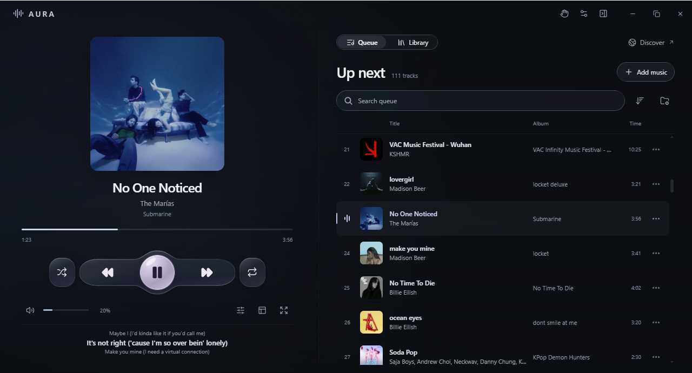
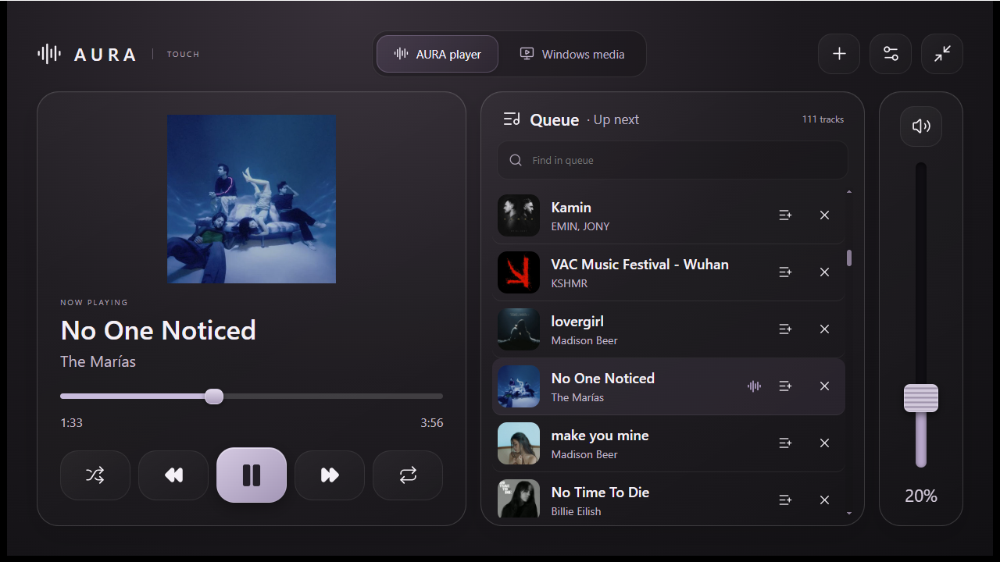
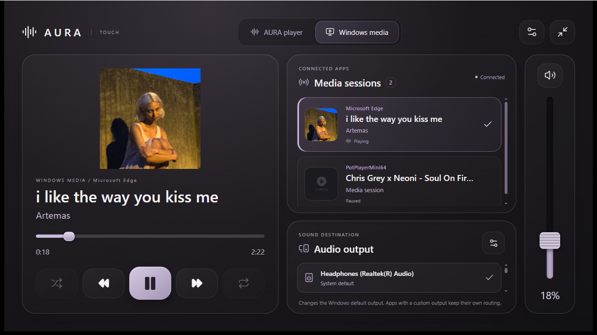
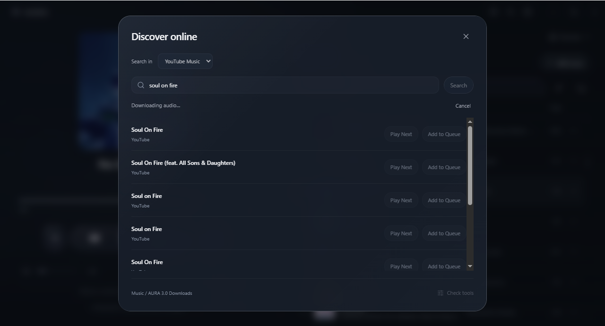

<div align="center">


# AURA

**Your music. Your space.**

An atmospheric, offline-first music player for Windows — with a new Liquid Glass interface, a dedicated touch experience, and integrated Windows media controls.

[](https://github.com/kaveesha-neth/AURA/releases/latest)

[](LICENSE)

[**Download AURA**](https://github.com/kaveesha-neth/AURA/releases/latest) · [Explore features](#the-experience) · [Technology](#built-with) · [AURA Legacy](#aura-legacy)

<br />



<sub>Music first. Everything else, within reach.</sub>

</div>

---

## The experience

AURA puts local music at the center, with subtle album-derived ambient lighting, customizable playback controls, synchronized lyrics, and a library designed for real collections.

<table>
<tr>
<td width="50%" valign="top">
<h3>Made for touch</h3>

<p>Fullscreen controls, searchable queue, and a vertical volume fader — all synchronized with desktop playback.</p>
</td>
<td width="50%" valign="top">
<h3>Control Windows media</h3>

<p>Switch between your AURA library and compatible Windows media sessions. Select playback outputs and manage system volume.</p>
</td>
</tr>
<tr>
<td width="50%" valign="top">
<h3>Discover & bring music home</h3>

<p>Search YouTube and YouTube Music, download supported audio through external tools, and add it to your local library or queue.</p>
</td>
<td width="50%" valign="top">
<h3>Make it yours</h3>
<p><strong>Sculpted or Classic controls.</strong> OLED mode or artwork-driven atmosphere. A five-band equalizer, reduced effects, immersive lyrics, and floating always-on-top lyrics.</p>
<p><strong>Library + Queue.</strong> Separate searchable views, virtualized desktop lists, drag-to-reorder, Play Next, shuffle history, and repeat.</p>
<p><strong>Pick up where you left off.</strong> Restore the queue, selected track, playback position, and playback preferences.</p>
</td>
</tr>
</table>

## Built with

<div align="center">


**[Glisse](https://github.com/0kzh/glisse)** · **[Lucide](https://lucide.dev/)** · **Windows Core Audio** · **Windows Media Session APIs** · **Web Audio API**

</div>

| Layer | How AURA uses it |
|:--|:--|
| **Electron** | Native desktop windows, local library access, packaging, and IPC |
| **React + TypeScript + Vite** | Composed interface, library and queue views, touch UI, and frontend builds |
| **Glisse + Lucide** | Liquid Glass surfaces and a consistent icon system |
| **JavaScript audio controller + Web Audio API** | Local playback orchestration, queue, synchronized lyrics, and equalization |
| **.NET 8 / WinRT** | Bundled Windows media-session bridge for compatible external players |
| **PowerShell + Windows Core Audio** | Master volume and playback-device integration |
| **yt-dlp + FFmpeg** | Optional external download and media-processing tools for Discover |

> **Architecture note:** AURA uses a hybrid renderer: React owns the modern interface, while the retained JavaScript controller coordinates parts of playback and state. The Windows media bridge is self-contained; end users don't need to install .NET separately.

## Get AURA

<div align="center">

### [⬇ Download the latest Windows release](https://github.com/kaveesha-neth/AURA/releases/latest)

**Windows 10 / 11 · x64 · Installer**

[Release notes](https://github.com/kaveesha-neth/AURA/releases/latest) · [Report an issue](https://github.com/kaveesha-neth/AURA/issues/new)

</div>

AURA installs independently of AURA Legacy, with a separate app ID and data profile. It does **not** automatically import your older library or settings. Automatic updates are currently disabled; future releases need to be installed manually until the new update feed is configured.

The optional Discover downloader relies on external yt-dlp and FFmpeg executables. External Windows media controls work only with applications that expose supported Windows media sessions; audio-output switching changes Windows defaults rather than per-app routing.

## AURA Legacy

The original AURA interface is preserved as **AURA Legacy v2.4.0**.

[**Download AURA Legacy**](https://github.com/kaveesha-neth/AURA/releases/tag/v2.4.0) · [Browse legacy source](https://github.com/kaveesha-neth/AURA/tree/legacy/v2)

## For developers

AURA is built with Electron, React, TypeScript, Vite, and a native Windows media bridge. For local development on Windows, use Node.js 22.12+ and the .NET 8 SDK.

```powershell
npm install
npm run dev
```

`npm run build-win` produces the Windows installer. More architecture details and verification utilities are documented in [`docs/`](docs/) and the [UI redesign report](AURA-3.0-REDESIGN-REPORT.md).

---

<div align="center">

Designed and developed by **Kaveesha Nethmal**  
© 2026 · [License](LICENSE)

</div>
